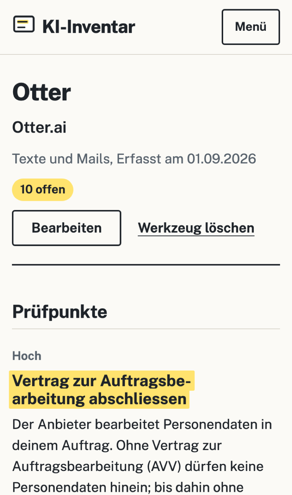

# KI-Inventar für Schweizer KMU

Ein kostenloses Verzeichnis der KI-Werkzeuge, die eine Firma einsetzt, und was daraus zu tun ist.
Jedes Werkzeug wird mit zehn Fragen erfasst; daraus entstehen Prüfpunkte mit Grund und Gesetzesstelle
nach dem Schweizer Datenschutzgesetz (DSG) und der EU-KI-Verordnung, dazu die Fristen der
KI-Verordnung mit dem Hinweis, wann sie ein Schweizer Unternehmen überhaupt betreffen. Alles bleibt im
Browser: kein Konto, kein Server, keine Übermittlung.

**Live:** https://adambaranyi.github.io/ki-inventar/

**Keine Rechtsberatung.** Das Werkzeug übersetzt Angaben in Prüfpunkte; verbindlich sind der
Gesetzestext und eine Fachberatung. Rechtsstand geprüft am 11.10.2026 gegen
[fedlex](https://www.fedlex.admin.ch/eli/cc/2022/491/de) (DSG, Stand 07.07.2025) und
[EUR-Lex](https://eur-lex.europa.eu/eli/reg/2024/1689/oj/deu) (Verordnung (EU) 2024/1689, geändert
durch die Digital-Omnibus-Verordnung (EU) 2026/1744).

<p>
  
  
</p>

## Was es tut

- **Erfassen:** zehn Fragen je Werkzeug, vom Standort des Anbieters über Personendaten, Training und
  Vertrag zur Auftragsbearbeitung bis zu EU-Bezug und verbotenen Praktiken. Jede gültige Änderung
  speichert sich sofort. Was offen bleibt, zählt vorsichtig, also als möglich.
- **Prüfpunkte:** 14 Regeln als reine Funktionen (`src/app/fach/regeln.ts`). Jeder Punkt hat einen
  Grund, eine Quelle mit Link und einen Status: offen, erledigt oder trifft nicht zu (mit Begründung).
  Die jährliche Überprüfung wird nach 365 Tagen von selbst wieder fällig.
- **Fristen:** Zeitachse der KI-Verordnung nach dem Digital-Omnibus, mit einer Marke für heute.
- **Sichern und drucken:** JSON zum Wiederherstellen, CSV für Excel (Formeln entschärft), Verzeichnis
  als Druckansicht auf A4.

| Regel | Greift, wenn … | Prüfpunkt | Quelle |
|---|---|---|---|
| R1 | Personendaten nicht ausgeschlossen | Datenschutzerklärung ergänzen | DSG Art. 19 |
| R2 | Personendaten und kein AVV | Vertrag zur Auftragsbearbeitung | DSG Art. 9 |
| R3 | Personendaten und Anbieter ausserhalb CH/EWR | Bekanntgabe ins Ausland prüfen | DSG Art. 16, 17 |
| R4 | besonders schützenswerte Daten | Einwilligung oder Grundlage, Folgenabschätzung | DSG Art. 6 Abs. 7, Art. 22 |
| R5 | Training nicht ausgeschlossen und vertrauliche Eingaben | Training ausschliessen | DSG Art. 7, 8 |
| R6 | private Konten und vertrauliche Eingaben | Firmenkonto statt privater Konten | DSG Art. 8 |
| R7 | Entscheidungen über Personen ohne Mensch | Automatisierte Entscheidungen offenlegen | DSG Art. 21 |
| R8 | Personendaten in heiklem Einsatz | Datenschutz-Folgenabschätzung | DSG Art. 22 |
| R9 | Ausgaben an Dritte | KI-Inhalte kennzeichnen | KI-VO Art. 50 |
| R10 | nicht geschult | KI-Kompetenz fördern | KI-VO Art. 4 |
| R11 | EU-Bezug und Personal, Entscheidungen, Kredit oder Bildung | Hochrisiko-Einstufung prüfen | KI-VO Art. 26, Anhang III |
| R12 | verbotene Praktiken | Einsatz stoppen | KI-VO Art. 5 |
| R13 | niemand verantwortlich | Verantwortliche Person benennen | gute Praxis |
| R14 | immer | Eintrag jährlich überprüfen | gute Praxis |

## Technik

Angular 22 (standalone, Signals, zoneless, Reactive Forms), TypeScript strict, Zod 4, Bun, keine
UI-Bibliothek. Schrift Public Sans lokal. Statisch auf GitHub Pages.

- **Strenge CSP** ohne Inline-Skripte und Inline-Stile: Komponenten haben keine eigenen Stile, alle
  Stile liegen als Dateien neben den Komponenten und werden gebündelt. Zod läuft `jitless`.
  Begründung und Grenzen: [docs/SECURITY.md](docs/SECURITY.md).
- **Keine Netzaufrufe zur Laufzeit**, geprüft im Browser-Test: nur GET an den eigenen Ursprung.

## Prüfen

```bash
bun install
bun run check
```

`check` führt Quelltext-Regeln (400 Zeilen je Datei, Zod nur über `src/app/zod.ts`, keine
Komponenten-Stile, keine Schrift unter 16 px), Unit-Tests mit Vitest, die Tests der
Sicherheitsskripte, den Build und die Browser-Tests mit Playwright aus. Die Browser-Tests prüfen den
gebauten Stand hinter einem Server, der sich wie GitHub Pages verhält, in drei Breiten (375, 390 und
1280 px): axe ohne Befund, keine Schrift unter 16 px, Tippflächen ab 44 px, kein Querscrollen, keine
CSP-Verstösse, keine Anfrage an fremde Ursprünge, dazu die Kette «Beispiel laden, bearbeiten,
erledigen, drucken, exportieren, neu laden».

```bash
bun run sabotage
```

baut 42 Fehler ein (jede Regel umgekehrt, Speicher, CSV, Quelltext-Regeln, Browser-Grundregeln) und
verlangt, dass jedes Mal ein Test rot wird.

## Bewusst nicht gebaut

- **Kein Server und kein Konto.** Ein Werkzeug, das Datenschutz prüft, soll keine Daten einsammeln.
  Darum gibt es keinen Abgleich zwischen Geräten; die Sicherung als Datei ersetzt ihn.
- **Keine Sicherheits-Header** wie HSTS oder `X-Frame-Options`: GitHub Pages erlaubt keine eigenen
  Header. Sie kommen mit dem Umzug auf eine eigene Subdomain.
- **Keine PDF-Erzeugung im Code.** Der Druck des Browsers erzeugt das PDF; das spart eine Bibliothek.
- **Nur Deutsch.** Alle Texte liegen in `src/app/texte/`; Französisch, Italienisch und Englisch
  folgen dort.

Stand und nächste Schritte: [docs/STATUS.md](docs/STATUS.md).
