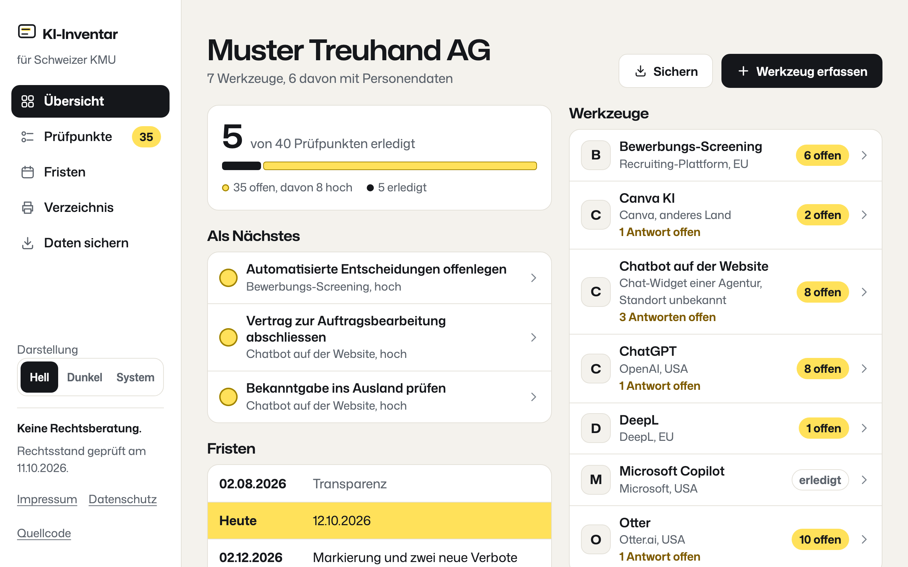
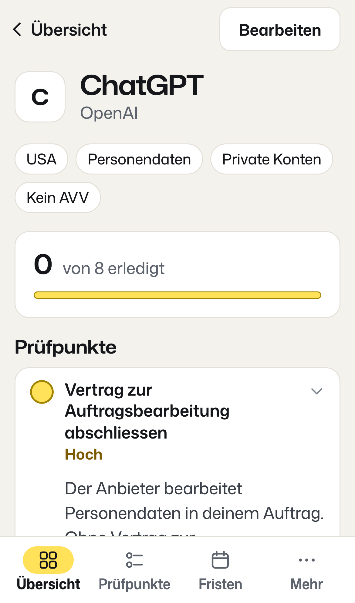
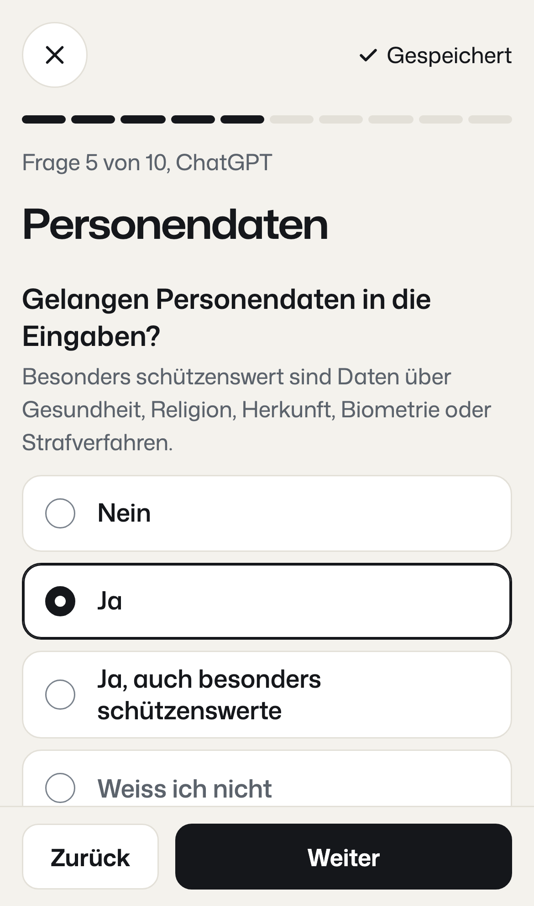

# KI-Inventar für Schweizer KMU

Ein kostenloses Verzeichnis der KI-Werkzeuge, die eine Firma einsetzt, und was daraus zu tun ist.
Jedes Werkzeug wird mit zehn Fragen erfasst; daraus entstehen Prüfpunkte mit Grund und Gesetzesstelle
nach dem Schweizer Datenschutzgesetz (DSG) und der EU-KI-Verordnung, dazu die Fristen der
KI-Verordnung mit dem Hinweis, wann sie ein Schweizer Unternehmen überhaupt betreffen. Alles bleibt im
Browser: kein Konto, kein Server, keine Übermittlung.

**Live:** https://ki-inventar.adambaranyi.xyz (eigener Server mit Sicherheits-Kopfzeilen) und
https://adambaranyi.github.io/ki-inventar/ (GitHub Pages).

**Keine Rechtsberatung.** Das Werkzeug übersetzt Angaben in Prüfpunkte; verbindlich sind der
Gesetzestext und eine Fachberatung. Rechtsstand geprüft am 11.10.2026 gegen
[fedlex](https://www.fedlex.admin.ch/eli/cc/2022/491/de) (DSG, Stand 07.07.2025) und
[EUR-Lex](https://eur-lex.europa.eu/eli/reg/2024/1689/oj/deu) (Verordnung (EU) 2024/1689, geändert
durch die Digital-Omnibus-Verordnung (EU) 2026/1744).

<p>
  
  
  
</p>

## Was es tut

- **Erfassen:** zehn Fragen je Werkzeug, eine je Bildschirm, vom Ort der Bearbeitung über
  Personendaten, Training und Vertrag zur Auftragsbearbeitung bis zu EU-Bezug und verbotenen
  Praktiken. Jede gültige Änderung speichert sich sofort. «Weiss ich nicht» lässt eine Antwort offen;
  sie erscheint als offene Antwort, und die Datenschutz-Regeln zählen sie vorsichtig mit.
- **Vorlagen:** Für ChatGPT, Microsoft Copilot, Claude, Gemini und DeepL schlägt die erste Frage je
  Variante (privat oder Firma) Antworten zu Anbieter, Zugang, Training und AVV vor, mit Hinweis und
  Quellen (`src/app/fach/vorlagen.ts`, Stand 12.10.2026). Eine Vorlage füllt nur Offenes und nie
  den Standort.
- **Prüfpunkte:** 14 Regeln als reine Funktionen (`src/app/fach/regeln.ts`). Jeder Punkt hat einen
  Grund, eine Quelle mit Link und einen Status: offen, erledigt oder trifft nicht zu (mit Begründung).
  Die jährliche Überprüfung wird nach 365 Tagen von selbst wieder fällig. Die Übersicht zeigt den
  Fortschritt und die drei dringendsten offenen Punkte.
- **Fristen:** Zeitachse der KI-Verordnung nach dem Digital-Omnibus, mit einer Marke für heute.
- **Sichern und drucken:** JSON zum Wiederherstellen, CSV für Excel (Formeln entschärft), Verzeichnis
  als Druckansicht auf A4.
- **Bearbeitungsverzeichnis:** Entwurf nach Art. 12 DSG als CSV, eine Zeile je Werkzeug mit
  Personendaten; Unbekanntes steht als «zu ergänzen» da, die Befreiung nach Art. 24 DSV ist erklärt.
- **Kalender:** Termine für die jährliche Überprüfung als `.ics` (RFC 5545, ganztägig mit
  Erinnerung um 9 Uhr).
- **Darstellung:** hell (Vorgabe), dunkel oder wie das Gerät; Umschalter in der Seitenleiste und unter
  «Mehr». Gedruckt immer hell.

| Regel | Greift, wenn … | Prüfpunkt | Quelle |
|---|---|---|---|
| R1 | Personendaten nicht ausgeschlossen | Datenschutzerklärung ergänzen | DSG Art. 19 |
| R2 | Personendaten und kein AVV | Vertrag zur Auftragsbearbeitung | DSG Art. 9 |
| R3 | Personendaten und Bearbeitung ausserhalb CH/EWR | Bekanntgabe ins Ausland prüfen | DSG Art. 16, 17 |
| R4 | besonders schützenswerte Daten | Einwilligung oder Grundlage, Folgenabschätzung | DSG Art. 6 Abs. 7, Art. 22 |
| R5 | Training nicht ausgeschlossen und vertrauliche Eingaben | Training ausschliessen | DSG Art. 7, 8 |
| R6 | private Konten und vertrauliche Eingaben | Firmenkonto statt privater Konten | DSG Art. 8 |
| R7 | Entscheidungen über Personen ohne Mensch | Automatisierte Entscheidungen offenlegen | DSG Art. 21 |
| R8 | Personendaten in heiklem Einsatz | Datenschutz-Folgenabschätzung | DSG Art. 22 |
| R9 | Ausgaben an Dritte | KI-Inhalte kennzeichnen | KI-VO Art. 50 |
| R10 | nicht geschult | KI-Kompetenz fördern | KI-VO Art. 4 |
| R11 | EU-Bezug und Personal, Entscheidungen, Kredit oder Bildung | Hochrisiko-Einstufung prüfen | KI-VO Art. 26, Anhang III |
| R12 | verbotene Praktiken | Einsatz stoppen | KI-VO Art. 5 |
| R13 | niemand verantwortlich | Verantwortliche Person benennen | gute Praxis |
| R14 | immer | Eintrag jährlich überprüfen | gute Praxis |

## Technik

Angular 22 (standalone, Signals, zoneless, Reactive Forms), TypeScript strict, Zod 4, Bun, keine
UI-Bibliothek und keine Icon-Bibliothek: eigene Bildzeichen als SVG-Pfade. Schrift Mona Sans
(variabel in Gewicht und Breite) lokal im Repo. Statisch auf GitHub Pages.

**Gestaltung «Prüfpult»:** weisse Blätter mit Haarlinie auf warmem Grund, keine Schatten. Tinte für
Text und Hauptaktionen, Leuchtstift-Gelb als einzige Datenfarbe für «offen», Rot nur für den Stopp
(R12). Am Handy eine Tab-Leiste mit vier Zielen, am Desktop eine Seitenleiste mit dem Rechtlichen
unten; der gewählte Punkt steht in Tinte, ein Werkzeug zählt zur Übersicht. Schmale Seiten stehen
mittig neben der Seitenleiste. Schrift nie unter 16 px, Tippflächen ab 44 px.

- **Strenge CSP** ohne Inline-Skripte und Inline-Stile: Komponenten haben keine eigenen Stile, alle
  Stile liegen als Dateien neben den Komponenten und werden gebündelt. Zod läuft `jitless`.
  Begründung und Grenzen: [docs/SECURITY.md](docs/SECURITY.md).
- **Keine Netzaufrufe zur Laufzeit**, geprüft im Browser-Test: nur GET an den eigenen Ursprung.

## Prüfen

```bash
bun install
bun run check
```

`check` führt Quelltext-Regeln (400 Zeilen je Datei, Zod nur über `src/app/zod.ts`, keine
Komponenten-Stile, keine Schrift unter 16 px), Unit-Tests mit Vitest, die Tests der
Sicherheitsskripte, den Build und die Browser-Tests mit Playwright aus. Die Browser-Tests prüfen den
gebauten Stand hinter einem Server, der sich wie GitHub Pages verhält, in drei Breiten (375, 390 und
1280 px): axe ohne Befund, keine Schrift unter 16 px, Tippflächen ab 44 px, kein Querscrollen, keine
CSP-Verstösse, keine Anfrage an fremde Ursprünge, dazu die Kette «Beispiel laden, bearbeiten,
erledigen, drucken, exportieren, neu laden».

```bash
bun run sabotage
```

baut 77 Fehler ein (jede Regel umgekehrt, Fortschritt, Speicher, CSV, Bearbeitungsverzeichnis,
Kalender, Vorlagen, Formular-Schritte, Rahmen, Quelltext-Regeln, Browser-Grundregeln) und verlangt,
dass jedes Mal ein Test rot wird. Die Darstellung prüft `e2e/darstellung.spec.ts`: hell als Vorgabe
auch auf dunkel eingestellten Geräten, die Wahl bleibt nach dem Neuladen, kein Aufblitzen beim
Laden. Den Rahmen prüft `e2e/rahmen.spec.ts`: Spalte mittig, Rechtliches je Breite an seinem Platz,
gewählter Menüpunkt auch unter der Maus in Tinte.

Zwei geplante Läufe erinnern per Issue: wöchentlich an offene Pull Requests, monatlich an
Rechtsstand, Fristen und Vorlagen.

## Bewusst nicht gebaut

- **Kein Server und kein Konto.** Ein Werkzeug, das Datenschutz prüft, soll keine Daten einsammeln.
  Darum gibt es keinen Abgleich zwischen Geräten; die Sicherung als Datei ersetzt ihn.
- **Keine Kopfzeilen auf GitHub Pages:** Pages erlaubt keine eigenen. Die Adresse auf dem eigenen
  Server (`ki-inventar.adambaranyi.xyz`, Abbild aus `infra/`) setzt CSP mit `frame-ancestors`,
  HSTS und die übrigen Sicherheits-Kopfzeilen.
- **Keine PDF-Erzeugung im Code.** Der Druck des Browsers erzeugt das PDF; das spart eine Bibliothek.
- **Nur Deutsch.** Alle Texte liegen in `src/app/texte/`; Französisch, Italienisch und Englisch
  folgen dort.

Stand und nächste Schritte: [docs/STATUS.md](docs/STATUS.md).

## Lizenz

Alle Rechte vorbehalten. Der Quelltext ist öffentlich, damit er gelesen und beurteilt werden kann;
Nutzung, Veränderung und Weitergabe brauchen eine schriftliche Erlaubnis. Einzelheiten und
Bestandteile Dritter: [LICENSE](LICENSE).
